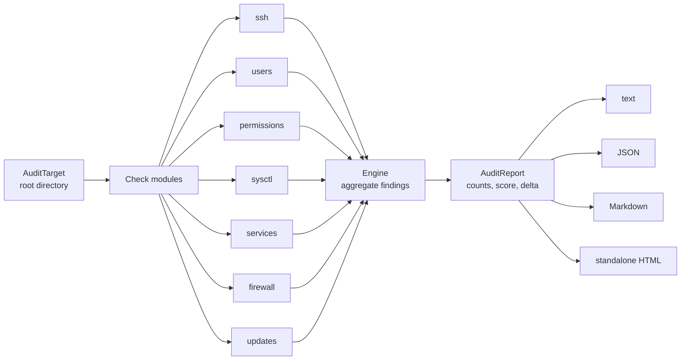

# linux-baseline-audit

A read-only, CIS-aligned baseline auditor for Linux servers. It evaluates **41
hardening rules** across SSH, accounts, file permissions, kernel networking,
services, firewall and patch management, and produces terminal, JSON, Markdown
or standalone HTML reports — with no dependencies and no changes to the audited
host.

[](https://github.com/jeremydacosta-TechOptimist/linux-baseline-audit/actions/workflows/ci.yml)
[](https://www.python.org/downloads/)
[](LICENSE)

Configuration drift is where servers quietly become insecure: a temporary
`PermitRootLogin yes`, a forgotten `telnet.socket`, an open sudo rule. Manual
CIS checklist reviews are slow and inconsistent. `baseaudit` turns that review
into a repeatable command: it reads the relevant files, applies a fixed rule
catalogue, and reports every deviation with its severity, evidence and
remediation.

The auditor is deliberately read-only. It never runs `systemctl`, never writes
to the audited tree and never opens a network socket. Because it works on a
**directory tree** (`--root`), it can also audit an extracted backup, an
unmounted disk image or a configuration snapshot from a workstation — without
root privileges on the target.

## Features

- **41 rules in 7 categories**: SSH daemon, accounts and privileges, file
  permissions, kernel network hardening, systemd services, host firewall and
  patch management. Every rule carries an id (`SSH-01` …), a severity, a CIS
  reference, the observed evidence and a remediation hint.
- **Offline by design**: audit any directory tree with `--root`; POSIX-only
  rules degrade to an explicit `SKIP` on platforms where file modes are not
  meaningful, instead of pretending to pass.
- **Four report formats**: terminal text, machine-readable JSON (round-trippable),
  GitHub-flavoured Markdown and a standalone HTML dashboard with no external
  assets.
- **Change tracking**: `baseaudit diff old.json new.json` classifies rule-level
  regressions and fixes and shows the score delta, which fits change windows and
  configuration reviews.
- **CI gate**: `--fail-on critical` (or `low`/`medium`/`high`) makes the command
  exit non-zero when a finding at that severity exists.
- **Weighted compliance score**: critical findings weigh more than low ones, and
  warnings earn half credit, so the number moves in proportion to risk.
- **Rule catalogue**: `baseaudit rules` lists every check for reviews and
  documentation, filterable by category.
- **Zero dependencies**: Python 3.10+ standard library only, one package,
  installable with `pip` or `pipx`.

## Quick start

```bash
git clone https://github.com/jeremydacosta-TechOptimist/linux-baseline-audit.git
cd linux-baseline-audit
python -m pip install -e .
baseaudit audit --root examples/lab-server
```

The bundled `examples/lab-server` is a synthetic, intentionally imperfect
snapshot (no real credentials). A full run against it starts like this (absolute
paths shortened for readability; the full report lists all findings):

```text
baseaudit 1.0.0 audit report
Target   : examples/lab-server
Platform : Windows
Generated: 2026-11-16T16:59:12+00:00

Score: 58/100   rules=41   PASS=20  FAIL=10  WARN=4  SKIP=7

FAILURES (10)
  SSH-01   [CRITICAL] SSH root login is disabled
           evidence: PermitRootLogin yes
           fix: Set 'PermitRootLogin no' in /etc/ssh/sshd_config and reload sshd.
  USR-01   [CRITICAL] Only the root account has UID 0
           evidence: 1 non-root account(s) share UID 0
           - backdoor
           fix: Remove or renumber every other account that shares UID 0.
  SYS-03   [MEDIUM  ] ICMP redirects are not accepted
           evidence: net.ipv4.conf.all.accept_redirects = 1 (expected 0)
           fix: Set net.ipv4.conf.all.accept_redirects = 0.
  ...
  UPD-01   [HIGH    ] Automatic updates are enabled
           evidence: APT::Periodic::Update-Package-Lists=1, APT::Periodic::Unattended-Upgrade=0
           fix: Enable unattended-upgrades (APT) or dnf-automatic so security patches apply automatically.

CATEGORY SUMMARY
  category     PASS FAIL WARN SKIP
  ssh             7    1    0    1
  users           3    3    1    0
  permissions     0    0    0    6
  sysctl          7    2    1    0
  services        2    1    1    0
  firewall        0    2    1    0
  updates         1    1    0    0

10 failure(s) need attention.
```

The command exits with code `1` because failures at or above the default
`--fail-on high` threshold exist. Use `--fail-on none` when you only want the
report.

## Usage

### Audit one category

```bash
baseaudit audit --root examples/lab-server --category ssh
```

```text
baseaudit 1.0.0 audit report
Target   : examples/lab-server
Platform : Windows
Generated: 2026-11-16T16:59:20+00:00

Score: 81/100   rules=9   PASS=7  FAIL=1  WARN=0  SKIP=1

FAILURES (1)
  SSH-01   [CRITICAL] SSH root login is disabled
           evidence: PermitRootLogin yes
           fix: Set 'PermitRootLogin no' in /etc/ssh/sshd_config and reload sshd.

SKIPPED (not applicable) (1)
  SSH-09   [HIGH    ] sshd_config is not writable by group or others
           evidence: POSIX file modes are not available on this platform

CATEGORY SUMMARY
  category     PASS FAIL WARN SKIP
  ssh             7    1    0    1

1 failure(s) need attention.
```

### JSON for automation

```bash
baseaudit audit --root examples/lab-server --format json --fail-on none -o report.json
```

```text
report written to report.json
```

The JSON carries a schema version, the summary, per-category counters and one
entry per rule (id, category, severity, status, evidence, remediation). It can be
re-rendered later without re-running the audit:

```bash
baseaudit report report.json --format html -o report.html
```

### Regressions between two audits

```bash
baseaudit diff baseline.json latest.json
```

```text
Report comparison

Old report: examples/lab-server  (generated 2026-11-16T16:59:52+00:00)
New report: lab-server-hardened   (generated 2026-11-16T16:59:52+00:00)
Score: 58 -> 63 (+5)
Failures: 10 -> 9   Warnings: 4 -> 4   Passes: 20 -> 21

REGRESSIONS (0)

FIXES (1)
  SSH-01   FAIL -> PASS  SSH root login is disabled
```

Paths are shortened here; the real command prints the two report targets.
`diff` exits `0` and is meant to be read in a change review: a non-empty
`REGRESSIONS` section means a change window made the host worse.

### HTML report

```bash
baseaudit audit --root examples/lab-server --format html --fail-on none -o report.html
```

`report.html` is fully self-contained (inline CSS, no scripts, no CDN), so it can
be attached to a change ticket or opened from a shared drive.

### Rule catalogue

```bash
baseaudit rules --category firewall
```

```text
baseaudit 1.0.0 rule catalogue (3 rules)

RULE     SEVERITY  CATEGORY     TITLE                                          REFERENCE
FW-01    high      firewall     Host firewall is active                        CIS 3.5.1
FW-02    high      firewall     Default inbound policy is deny                 CIS 3.5.2
FW-03    medium    firewall     Firewall configuration is enabled at boot      CIS 3.5.1
```

### Exit codes

| Code | Meaning |
| --- | --- |
| `0` | Audit completed and no failure at or above the `--fail-on` severity |
| `1` | Audit completed, at least one failure at or above the threshold (or a runtime error) |
| `2` | Usage error (bad arguments, missing/invalid `--root`) |

## Architecture



Every check module receives the same `AuditTarget`, a read-only view of a
directory tree with small helpers (`read_text`, `glob`, `stat`). Checks never
touch absolute paths directly, which is what makes the same code work against
`/`, a mounted snapshot or a temporary fixture tree. The engine merges the
findings, sorts them in canonical category order and computes the weighted
score. Renderers are pure functions over the resulting `AuditReport`, and the
JSON renderer is the only one that has a parser (`report`, `diff`).

The parsers are intentionally hand-written: `sshd_config`, `sysctl`, APT
fragments and sudoers are not INI files, and a permissive line-oriented parser
handles real-world files (comments, duplicate keywords, `Include` drop-ins,
`key = value` and `key=value` forms) more faithfully than a generic one.

## Project layout

```text
linux-baseline-audit/
├── .github/workflows/ci.yml   # Python 3.10-3.13 matrix, pytest
├── examples/
│   ├── README.md
│   └── lab-server/            # synthetic snapshot used by the demo
├── src/baseaudit/
│   ├── cli.py                 # argparse commands: audit, rules, report, diff
│   ├── engine.py              # selects modules, aggregates the report
│   ├── model.py               # Rule, Finding, Status, Severity, AuditReport
│   ├── parsers.py             # sshd/sysctl/passwd/shadow/sudoers/ufw/APT parsers
│   ├── report.py              # text, JSON, Markdown, HTML and diff renderers
│   ├── target.py              # read-only AuditTarget abstraction
│   └── checks/                # one module per category (ssh, users, ...)
└── tests/                     # 104 tests + fixture helpers
```

## Rule coverage

| Category | Rules | Examples |
| --- | --- | --- |
| SSH | 9 | root login, password auth, MaxAuthTries, grace time, banner, keep-alive, config mode |
| Users | 7 | extra UID 0 accounts, empty password hashes, aging, duplicate UIDs, NOPASSWD, `use_pty` |
| Permissions | 6 | `/etc/passwd`, `/etc/shadow`, `/etc/group`, `/etc/gshadow`, `sshd_config`, `sudoers` |
| sysctl | 10 | IP forwarding, source routing, ICMP redirects, rp_filter, SYN cookies, ASLR |
| Services | 4 | SSH enabled, telnet/rsh/tftp disabled, avahi/cups, rpcbind |
| Firewall | 3 | active firewall, default deny inbound, enabled at boot |
| Updates | 2 | unattended upgrades/dnf-automatic, metadata freshness |

POSIX file-mode rules report `SKIP` with an explicit reason on platforms without
POSIX metadata (for example when running the demo from Windows).

## Testing

```bash
python -m pip install -e ".[dev]"
python -m pytest -q
```

The suite contains **104 tests** and also runs under the standard library
runner:

```bash
python -m unittest discover -s tests -v
```

Coverage includes the parsers, every check family (pass, fail, warning and skip
paths), `Include` precedence for sshd, sysctl override order, permission checks
with mocked `stat`, package-metadata freshness with an injected clock, report
rendering and round-trip, regression/fix classification, and end-to-end CLI
behaviour via subprocess (exit codes, JSON output, HTML output, `report` and
`diff` commands).

## Safety

- Read-only: the auditor never writes to the audited tree, never executes
  `systemctl`, `iptables`, `sysctl` or `sshd`, and never opens a network socket.
- No dependencies, no daemon, no privilege escalation: run it as an ordinary
  user against a copy or as root for live file permissions.
- The synthetic lab snapshot contains placeholder hashes, not credentials.

## Roadmap

- POSIX ownership checks (root-owned files, `shadow` group) and a broader
  world-writable scan of `/etc`.
- Optional live mode on Linux reading `/proc/sys` and `sshd -T`, still read-only.
- SARIF 2.1.0 output so findings appear in GitHub code scanning.
- Distribution profiles (Debian/Ubuntu vs RHEL) to reduce false positives on
  distribution-specific defaults.

## Resumo em português (PT-PT)

- Auditor de *baseline* para servidores Linux, alinhado com as boas práticas CIS
  e sem dependências externas (apenas a biblioteca padrão do Python 3.10+).
- 41 regras em 7 categorias — SSH, contas e privilégios, permissões, sysctl,
  serviços, firewall e atualizações — cada uma com gravidade, evidência e
  remediação.
- Funciona offline sobre uma árvore de ficheiros (`--root`), o que permite
  auditar uma imagem ou cópia de segurança sem privilégios de root.
- Relatórios em texto, JSON, Markdown e HTML autónomo, comando `diff` para
  comparar duas auditorias e detetar regressões, e código de saída adequado a
  pipelines de CI.
- 104 testes automatizados e integração contínua em Python 3.10–3.13.

## License

MIT © 2026 Jeremy da Costa — see [LICENSE](LICENSE).
